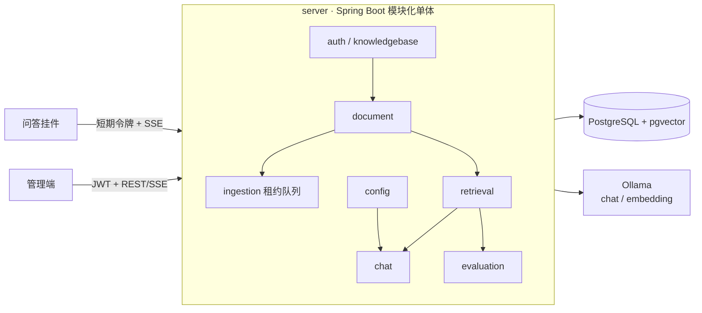

# 知库 RAG

[](https://github.com/suijiafeng/zhiku-rag-prep/actions/workflows/ci.yml)

面向企业内部制度与知识的检索增强问答（RAG）系统：员工就制度提问，回答只依据**有权访问且当前生效**的资料，并给出可核对的来源。

> **状态：开发中，未达到生产可用。** 身份使用本地签发的开发令牌，模型使用本地 Ollama；仓库中只有虚构示例数据，没有真实企业材料，也不调用付费模型。生产接入前仍需企业 IdP、业务决策（见 [ADR-002](docs/adr/002-open-decisions.md)）以及安全、性能和质量评测。

## 设计要点

- **授权先于检索**：每次请求从数据库重读知识库授权，先算出"可访问且生效"的版本集合，再在其中做向量检索；未授权内容不会进入模型、排序或响应。
- **业务效力与索引状态分离**：审批、发布、生效区间与解析/索引状态各自独立；未来生效的新版本可提前入库，不会顶替当前版本。
- **撤回与删除立即生效**：撤权、撤回或删除后，检索、引用、评测证据和依赖它的历史回答（含续问）立即不可见，物理清理在后台进行。
- **引用只做确定性校验**：服务端核对引用编号、来源版本与授权，界面只称"来源信息检查通过"，不宣称回答已被验证正确。
- **流式问答可中止、可对账**：POST + SSE，生成过程中周期重查授权与效力；断线后可按请求编号查询原请求结果，不重复生成。
- **可追溯**：问答、检索调试与评测共用同一检索链路，每次检索保存只含元数据的轨迹（不存问题与正文）。

## 功能

| 模块 | 已实现 |
|---|---|
| 身份与授权 | 本地 HS256 JWT、知识库授权、角色矩阵、管理员授权管理、追加式审计 |
| 文档 | 文档与内容版本、审批/发布/撤回、按时点的效力选择、删除与后台清理 |
| 摄取 | Markdown/TXT 上传校验、数据库租约任务队列（可恢复、续租、退避重试）、切块与向量化 |
| 检索 | 授权范围内精确向量检索、六阶段检索调试、按配置版本再运行与对比 |
| 问答 | SSE 流式回答、引用元数据校验、续问上下文与来源依赖、请求去重、敏感号码输入拦截、入模字符预算 |
| 反馈与评测 | 点赞/点踩与处理闭环、以原文区间为真值的检索评测、反馈转评测用例、关闭反馈须有回归依据 |
| 配置 | 知识库配置的候选 → 验证 → 发布 → 回滚，乐观锁防覆盖 |
| 前端 | 管理端 12 个页面；可嵌入问答挂件（短期令牌，不存长期凭据） |

**尚未实现**：生产 IdP/SSO、对话摘要、词法检索与融合/重排、引用语义验证与回答正确性人工评测、Embedding/切块参数的在线修改与重建、长期 API Key 与 Webhook。

## 架构



详见 [docs/architecture.md](docs/architecture.md)。接口与 SSE 协议见 [contracts/openapi.yaml](contracts/openapi.yaml)。

## 技术栈

- **server**：Java 21、Spring Boot 3.5、Spring JDBC、Flyway（V1–V23）、PostgreSQL 16 + pgvector 0.8
- **admin-web**：React 19、TypeScript 5.9、Ant Design 6、Vite 8
- **widget**：React + TypeScript，独立构建，样式隔离
- **测试**：JUnit 5 + Testcontainers（真实 pgvector）、Vitest + Testing Library（happy-dom）

## 快速开始

前置：Java 21、Maven 3.9+、Node 22+、Docker；如需真实问答，另装 [Ollama](https://ollama.com)。

```bash
cp .env.example .env
```

在 `.env` 中填入数据库密码和 `ZHIKU_JWT_SECRET`（可用 `openssl rand -base64 48` 生成）。

```bash
docker compose up -d postgres
```

```bash
# 后端不会自动读取 .env，需先导出到环境变量
set -a; source .env; set +a
cd server && mvn spring-boot:run
```

首次启动由 Flyway 建表。可选写入虚构示例知识库与授权：

```bash
docker compose exec -T postgres psql -U zhiku_local -d zhiku < scripts/dev-seed.sql
```

签发开发令牌（仅本地开发使用）：

```bash
node scripts/dev-token.mjs --user 00000000-0000-4000-8000-0000000000a1 --enterprise 00000000-0000-4000-8000-0000000000e1 --roles KB_OPERATOR,EMPLOYEE
```

启动管理端（Vite 代理到 127.0.0.1:8080），在登录页粘贴令牌：

```bash
cd admin-web && npm ci && npm run dev
```

**模型**：`.env` 中设 `ZHIKU_CHAT_PROVIDER=ollama` 启用问答，`ZHIKU_EMBEDDING_PROVIDER=ollama` 启用向量化（默认模型 bge-m3，需先 `ollama pull bge-m3`）。未配置 embedding 时文档会排队并说明原因，不会被标记为可检索。

## 测试

```bash
cd server && mvn -B clean verify
```

```bash
cd admin-web && npm ci && npm run check
```

```bash
cd widget && npm ci && npm run check
```

## 目录

```text
server/      后端（auth、knowledgebase、document、ingestion、retrieval、chat、evaluation、config、audit 等业务包）
admin-web/   管理端
widget/      可嵌入问答挂件
contracts/   OpenAPI 与 SSE 协议
scripts/     开发令牌签发、虚构示例种子数据（仅开发用）
docs/        架构、开发约定、ADR、验证记录
```

## 参与开发

本仓库按 [AGENTS.md](AGENTS.md) 约束开发（人与编码助手共用）：

1. 先读 [docs/architecture.md](docs/architecture.md)、[docs/conventions.md](docs/conventions.md)，在 [docs/adr/002-open-decisions.md](docs/adr/002-open-decisions.md) 确认未决事项。
2. 一次只做一个可验收目标，先补失败用例再做最小修改；改协议时同步契约与双端测试。
3. 提交使用 Conventional Commits，一个提交一个目的；未运行的检查不写"通过"。

## 安全与数据

- 身份只取自已验证的令牌，请求体不能携带企业、用户或角色；授权缺失默认拒绝，错误不暴露隐藏资源是否存在。
- 日志、测试与提交中不存真实问答、文档或凭据；测试只用虚构中性数据。
- `scripts/` 中的令牌签发与种子数据仅用于本地开发，生产必须接入企业 IdP。

## 许可

尚未指定开源许可证。

---
> **声明**：本仓库为个人项目，仅供学习交流。
